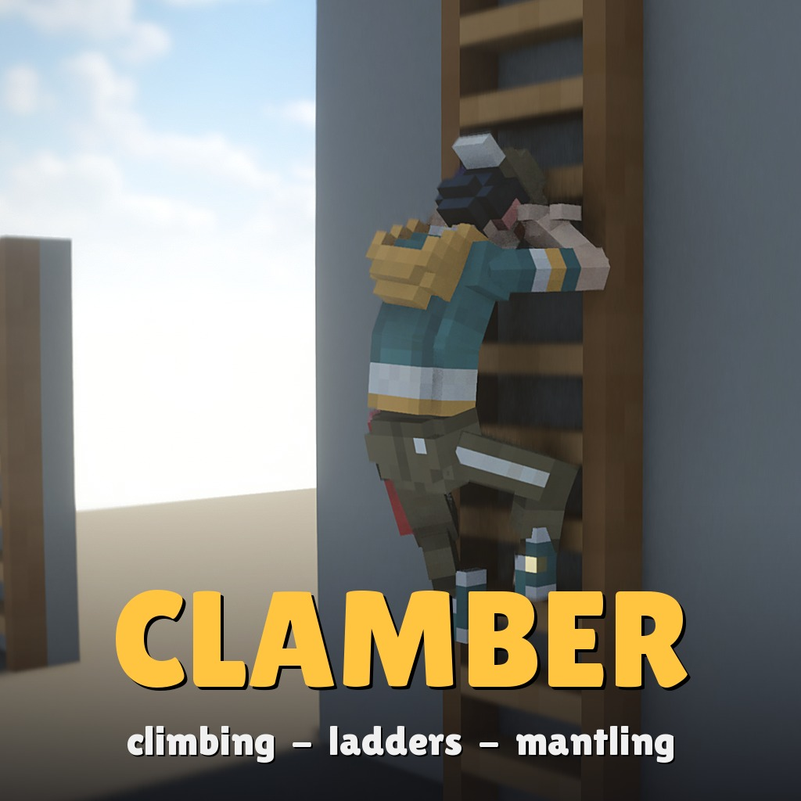

# Clamber: Climbing, Ladders & Mantling

**Ladders, climbable walls and mantling on any map, in single player and multiplayer** - a global mod for
[Teardown](https://teardowngame.com).



Climb ladders at any angle, climb vines, nets, trellises and rock faces in every direction, and pull yourself up onto
ledges. Hands and feet go on the rungs and on the wall, in the real rhythm of climbing.

## Multiplayer

Made for multiplayer: every player in the session climbs, and everyone sees everyone climb. The host runs the climbing
for all players; each player's game animates every climber. The host turns it on under Global mods.

## Controls

- **Ladders**: walk into one with forward, or press interact at it (at its top, interact climbs down onto it).
  Forward / back climb, left / right step off, jump jumps off, crouch lets go. At the top you climb over onto the floor.
- **Climbable walls**: grab with forward facing the wall, move with the movement keys, over the top at the edge; jump
  jumps off, crouch lets go. Grab a net from the water to climb out.
- **Mantling**: walk or jump into a ledge up to chest height, straight ahead, to pull yourself up. The height is an option (Mod Manager > Options): 1.4 m by default, from knee height (0.6 m) up to head height (1.8 m); in multiplayer the host's setting counts. Crouch: no mantle.
- **Spiderman mode** (an option, off by default): every static wall is climbable. Jump at a wall (or press interact at it) to grab it; walking along a wall doesn't grab it, low walls are still mantled, loose objects, vehicles and doors are never climbed. In multiplayer the host's setting counts.
- The hint at the bottom of the screen shows your own keys (or your gamepad's buttons).
- **Spawn menu**: Climbing > Ladder 3 m.

## For map makers and modders

Maps only mark what can be climbed - a location or a tag; the mod does the rest. Other mods can switch it off, block
a player, give a taller body more reach and more through registry keys. **[API.md](API.md)** has everything:

```xml
<location tags="ladder=4" pos="12.0 0.0 -3.5" rot="0 90 0"/>    <!-- a 4 m ladder; local -z = the way the climber faces -->
<body tags="ladder"><vox file="MOD/vox/my_ladder.vox"/></body>   <!-- or tag any body or shape -->
<body tags="climbable"><vox file="MOD/vox/vines.vox"/></body>    <!-- a wall you climb in every direction -->
```

## Community

Join the [Discord community](https://discord.gg/gNpRewdkxf) to post bug reports and suggestions.

## Install

Subscribe on the Steam Workshop, or clone this repository into `Documents/Teardown/mods/climbing`. Enable it under
Global mods.

## Credits

Made by AgeOfAlgorithms and Claude (Anthropic). MIT licence.
